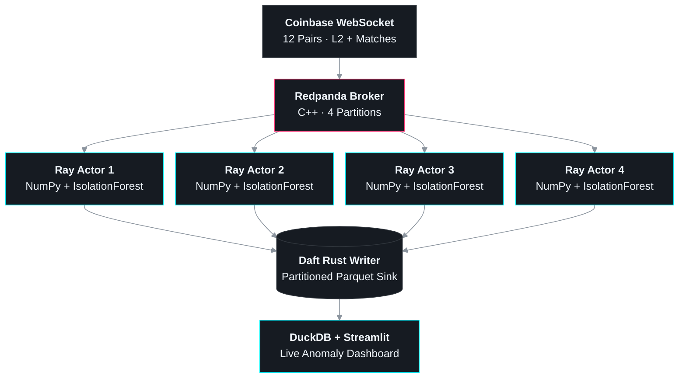

# Fluid: Zero-JVM Distributed Stream Engine

A high-throughput, zero-copy stream processing reference architecture built on **Redpanda**, **Ray**, and **Daft**—engineered to replace expensive Spark and Flink pipelines for real-time analytics and inline ML.

▶ **[Watch the 90-Second Live Chaos Failover Demo on YouTube](https://youtu.be/DAKHyepB16U)**

## Architecture



## Key Architectural Features

* **C-Level Network Ingestion (`Redpanda` + `librdkafka`):** Connects directly to Redpanda partitions via `librdkafka`, bypassing heavy JVM query planners to pull raw event bytes into RAM at sub-millisecond latency.
* **Stateful Distributed Orchestration (`Ray`):** Spawns a pool of isolated `@ray.remote` worker actors across compute nodes, decoupling network consumption and inline ML scoring from the main driver thread with automatic offset-checkpoint fault recovery.
* **Zero-Copy Columnar Storage (`Daft` + `Apache Arrow`):** Evaluates price velocity and volume ratios through `scikit-learn` `IsolationForest` models in memory, then uses Daft's Rust execution engine to write partitioned Parquet blocks in parallel.
* **Sub-10ms Analytical Telemetry (`DuckDB` + `Streamlit`):** Queries partitioned Parquet storage directly via DuckDB to power a live anomaly dashboard without a separate OLAP database.

## Repository Structure

* `src/fetch_feed.py` — Asynchronous WebSocket client streaming live order book and trade ticks into Redpanda across 12 markets.
* `src/fluid_stream.py` — Distributed Ray actor pool running inline `IsolationForest` anomaly detection and Daft Parquet writes (configurable via `NUM_WORKERS`).
* `src/dashboard.py` — Real-time DuckDB and Streamlit telemetry dashboard highlighting the top 4 most anomalous seconds inside the rolling 30-second window (with dot size scaled by total anomaly volume).
* `benchmarks/load_test.py` — Synthetic high-throughput load generator for reproducible multi-core stress testing (`REDPANDA_SMP=4 REDPANDA_MEMORY=8G NUM_WORKERS=16`).

## Quickstart

Ensure Docker (for Redpanda) and `uv` are installed, then launch the pipeline across three terminal panes:

```bash

# 1. Clone and sync dependencies
git clone https://github.com/noah-garner/fluid.git && cd fluid
uv sync

# 2. Start Redpanda (pre-configured with 4 default partitions)
docker compose up -d --wait

# 3. Run the ingestion feed, distributed Ray workers, and live dashboard
uv run src/fetch_feed.py
uv run src/fluid_stream.py
uv run streamlit run src/dashboard.py
```

Once running, inspect the `liquidity_transactions` topic in the [Redpanda Console](http://localhost:8080/topics/liquidity_transactions), or open the [live ML anomaly dashboard](http://localhost:8501).

## Consulting & Advisory

I help high-growth engineering teams replace expensive, serialization-bound Spark and Flink streaming pipelines with lean, Python-and-Rust engines that slash compute costs and run real-time analytics and inline ML at a fraction of the cluster footprint.

* **Get in Touch:** Connect with me on [LinkedIn](https://www.linkedin.com/in/noah-douglas-garner/) or schedule a brief [Technical Exploration Call](https://calendly.com/deltastreams/technical-exploration-call) to walk through your architecture.
